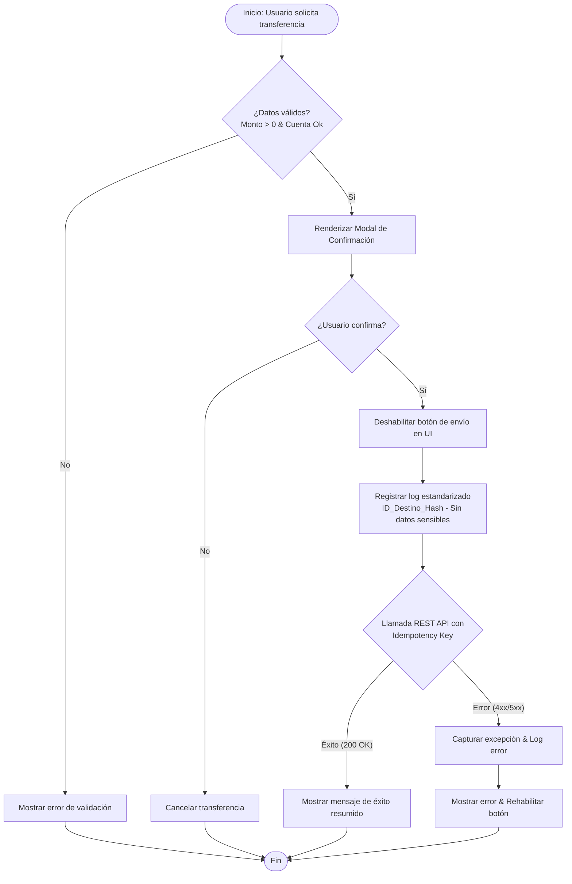

# Example Output: Anti-Duplicate Transfer Flow

## 1. Visual Diagram (PNG)

*(Nota: En producción, este bloque renderiza el gráfico PNG directamente para su descarga o visualización en la wiki del proyecto).*

## 2. Diagram Source Code

## 3. Flow Breakdown
1. **Validación Inicial:** Se evalúan el monto y la cuenta destino inmediatamente después de la acción del usuario. Si fallan, el flujo se detiene.
2. **Paso de Confirmación (Pre-send):** Se despliega un modal intermedio con los datos validados para que el usuario verifique la información.
3. **Bloqueo Anti-Duplicados en UI:** Al confirmar, se deshabilita instantáneamente el botón para prevenir el doble clic accidental.
4. **Registro Seguro:** Se guarda un log de auditoría asegurando que los datos sensibles (números de cuenta completos) viajen de forma cifrada/hasheada.
5. **Transacción Segura:** Se ejecuta la petición REST hacia los servicios de cuentas y transferencias inyectando una clave de idempotencia única para garantizar que el backend no procese la orden dos veces.

## 4. Key Components & Tech Stack
*   **Web Frontend:** Responsable de interceptar la acción, bloquear el botón de envío y pintar el resumen en el modal.
*   **Logger Service:** Encargado del registro estandarizado sin filtrar *PII* (Información Personal Identificable).
*   **Accounts & Transfers Services (REST API):** Capa de backend que procesa la transferencia e implementa el soporte para la *idempotency key*.

## 5. Edge Cases & Exceptions Handled
*   **Doble Clic:** Mitigado tanto en el Frontend (`disableSubmitButton()`) como en el Backend mediante la evaluación de la llave de idempotencia.
*   **Fallas de Red o de API (500/Timeout):** Captura limpia del error que permite volver a habilitar el control visual de la UI de forma controlada sin perder el estado seguro.

## 6. Open Questions / Ambiguities
*   **Línea base (Baseline):** El código actual no define qué métrica previa se usará para rastrear la reducción del 20% de quejas de usuarios.
*   **Contrato de API:** Se asume compatibilidad con la versión actual de la API REST para el envío de cabeceras de idempotencia, requiere validación del Tech Lead.
